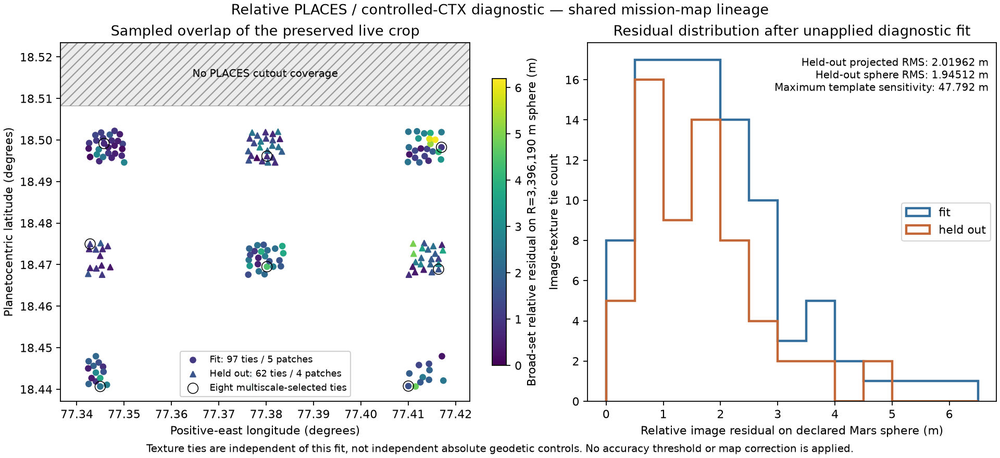

# Registration audit of the preserved REDLINE implementation

The native source frame and relative image measurements are reproducible. Absolute MDIM/named-feature registration remains unverified. This audit changes no application code, grid cell, source geotransform, route weight or scientific gate. The live 65,536-cell grid is the **controlled CTX DTM**, not the separately requested HiRISE DTM.

The evidence uses the accessible `mars-data-integrity` and `verification-before-completion` skills. Fresh saved-byte, source-geometry, frame and matching reruns are recorded here. No browser/device use, external contact, new source download or commit was performed by this lane.

## Source contracts and coordinate transformations

| Dataset | Exact identification | Native contract used here |
|---|---|---|
| Live numerical DEM | `JEZ_ctx_B_soc_008_DTM_MOLAtopography_DeltaGeoid_20m_Eqc_latTs0_lon0` | 1596 columns × 1512 rows; 20 m projected native cells; origin `[4573663.250853,1109693.140188]`m; crop rows 586–841/columns 522–777 inclusive |
| Controlled CTX image | `JEZ_ctx_B_soc_008_orthoMosaic_6m_Eqc_latTs0_lon0` | 5322 columns × 5040 rows; 6 m native projected pixels; same outer-corner origin; 12 m additional east extent |
| Actual PLACES map cutout | PDS Mars 2020 Rover PLACES release 16.0 `m20_orbital_map` / matching `best_tactical` records | 59200 samples × 21920 lines; 0.25 m projected pixels; three BSQ unsigned-byte bands; upper-left outer corner `[4340890,1097070]`m; native array offset 118400 bytes |
| Requested HiRISE DTM | `DTEEC_023524_1985_023379_1985_U01`, product version 1 | Stereo pair `ESP_023524_1985`/`ESP_023379_1985`; horizontal projection radius 3394839.8133163 m, standard parallel 15°, longitude origin 77.53°, spacing1.0096633268711 m |
| Preliminary CTX | `Jezero_CTX_BlockAdj_dd` | Display layer; native latitude/projection interpretation and quantitative cross-layer registration remain unverified |
| MOLA display layer | `Mars_MGS_MOLA_ClrShade_merge_global_463m` | Colorized shaded-relief context, not numerical elevation or an independent control-point set |

CTX and PLACES use planetocentric latitude, positive-east longitude and the same 3396190 m sphere. CTX uses `x=Rλ,y=Rφ`; PLACES uses `x=Rλ cos(18.4663°),y=Rφ`. Therefore the exact source-coordinate conversion is:

`x_CTX=x_PLACES/cos(18.4663°); y_CTX=y_PLACES`.

The numerical homogeneous matrix is recorded in [independent-residual-summary.json](independent-residual-summary.json). Its translation terms are zero. This projection conversion is not an empirically fitted scale or image correction. The CTX and PLACES upper-left origins refer to outer pixel corners; a native array element's centre is index+0.5. The independent source checker also confirms the PDS3 DEM one-based first-centre projection offsets without adding a second half pixel.

The requested HiRISE has a different horizontal model and explicitly stores metres above the **Mars 2000 Datum equipotential surface**. Its horizontal sphere must not be substituted for a vertical datum or transferred to the CTX crop. Its footprint is west77.45290261°/east77.59817341°/south18.159317160581°/north18.521550219233°. The live crop ends east77.42297207081594°; the envelopes have **no overlap**, with a longitude separation0.02993053918405°. A direct requested-HiRISE-to-live-crop registration test is therefore not applicable. Full native CTX coverage can overlap that DTM outside the live crop, but no paired controls were measured there.

## Reproduced relative image diagnostics

Nine lossless native PLACES first-band patches and the native CTX ranges were verified against saved receipts/hashes. A fixed3× 3 native-DEM sampling grid around rows 660/740/820 and columns 550/650/750 was set before matching. Five patches were assigned to the fit and four held out before matching. PLACES imagery was area-averaged to exact 6 m CTX cells for diagnostics; the DEM was never resampled.

The original Shi–Tomasi/NCC calculations were re-executed with the exact source SHA256 `b56d65cd491b9d3f380f97479f14fb675d3b8205d8a85337b52a0ab028ec166b` and the cached evidence-runtime pins. The resulting measurement JSON is **byte-identical** to the saved measurement: SHA256 `1569d8edc5ab7e6ad8eb653365d4160a33b4a7dabfa0abb46897465212cd5aec`. The wrapper omits only the original output/plot section, redirects possible blocker outputs here, and retains all calculation/matching parameters.

The broad set contains 97 fit ties and62 held-out ties. Its equal-patch median diagnostic translation is `[−0.6119473674577587,+0.4750237958644354]`m in CTX easting/northing. The multiscale subset contains 5 fit/3 held-out ties, selected by distinctive NCC quality across15/21/31-pixel templates without residual/sensitivity selection. Its translation is `[+0.0869525296116059,−1.0664313581747726]`m. **Neither translation is applied.** Scale and rotation are fixed by the coordinate contracts and were not independently fitted; spatial trends are not an independent distortion solution.

| Set/split | Count | Projected RMS(m) | Projected maximum(m) | Mars-sphere RMS(m) | Sphere maximum(m) | CTX-pixel RMS |
|---|---:|---:|---:|---:|---:|---:|
| Broad fit |97|2.319544748|6.249221172|2.266973799|6.113537083|0.386590791|
| Broad held out |62|2.019619400|5.222908398|1.945117168|4.961710333|0.336603233|
| Multiscale fit |5|1.809487558|2.817768065|1.788824632|2.813804291|0.301581260|
| Multiscale held out |3|1.971947323|2.193464792|1.932658433|2.110280131|0.328657887|

Broad held-out projected median is1.581618598 m; sphere median1.542212695 m; maximum CTX-pixel norm0.870484733. The broad held-out angular-plane RMS is0.0000340722008638°, maximum0.0000881136237961°; the selected held-out angular-plane RMS is0.0000332679440868°, maximum0.0000370050777715°. All longitude/latitude and CTX-row/column residual components are in [relative-image-residuals.csv](relative-image-residuals.csv), with 167 rows:159 broad observations plus the 8-member selected subset.

Projected residuals are Euclidean differences in the CTX equirectangular frame. Angular components are `dx/R,dy/R`, expressed in degrees. Angular-plane norm is a coordinate diagnostic. Physical distances use `R×atan2(||u×v||,u·v)` between the translated predicted coordinate and the matched coordinate on the declared Mars sphere; east-west projection scale differs at this latitude. CTX pixel components are column=`dx/6`, row=`−dy/6`. Native PLACES matched pixel arithmetic independently round-trips with maximum difference 0.0 pixels. These units do not imply HiRISE-pixel, DEM-cell or absolute accuracy.

The retained ties span77.3424149326–77.4174216418°E and18.4406531937–18.5021971602°N. The actual PLACES cutout omits903.140188 m at the crop's north. Nine sampled patches do not validate every cell, unsampled ground or that north strip. The maximum template-size sensitivity is47.792054564 m in the broader set, versus2.392242544 m among selected ties. That sensitivity is conditional matching sensitivity, not a confidence interval.



The fresh plot was inspected as a local image. It shows the unsampled north strip, all 159 retained ties, selected ties and residual distribution. Earlier lossless image-chip boards remain in the preserved evidence; this lane did not claim a new physical-landmark interpretation from visual similarity.

## Frame and named-reference checks

The PLACES frame audit and deterministic patch plan also reproduce byte-identically. All compared labels identify release 16.0. There are 666 CSV records,21 matching localized SITE records inside the crop and50 localized ROVER records with sols 659–779. SITE placeholders `sol=−1,sclk=0` provide no observation date. The current-versus-archived SPK maximum horizontal difference 0.0000365270857408 m establishes serialization agreement, not micrometre geolocation accuracy. The SIS expected 0.5 m `best_tactical` accuracy is relative to its own map and has no supplied statistical confidence or absolute-control guarantee.

The saved source-geometry audit verifies 10 HTTP receipts,3 Gazetteer records,4 crop corners and7 native centres; its output is byte-identical with SHA256 `c71cecf56f70f3467f3e722910b30361605a0a89be55ae5abb9a66dd66722364`. The source records identify **MDIM2.1**, planetocentric/+East:

| Feature | Gazetteer ID | Rounded coordinate | Arithmetic DEM row/column | In live crop |
|---|---|---|---|---|
| Jezero |14300|77.69°E,18.41°N|922/1569|No|
| Belva |15872|77.38°E,18.48°N|714/650|Yes|
| Neretva Vallis |15879|77.20°E,18.55°N|507/117|No|

These feature centres are approximate feature references, not precise independently identifiable texture controls or automatically selected endpoints. Equal coordinate conventions do not prove MDIM-to-local registration.

## Separate registration statuses

| Question | Status | Evidence and remaining gap |
|---|---|---|
| CTX image/DEM native georeferencing | **VERIFIED** | Exact labels, shared source frame/origin, VRT/first-centre/crop checks reproduce; physical absolute accuracy is a separate property |
| CTX-to-DEM physical registration | **PARTIALLY VERIFIED** | Shared stereo/orthorectification lineage plus bounded relative image diagnostic; independent CTX/DEM surveyed controls and an acceptance/uncertainty contract are absent |
| PLACES native frame/pixel interpretation | **VERIFIED** | Actual release-matched labels, SITE ancestry, native arithmetic and byte reproduction |
| PLACES-to-controlled-CTX relative image comparison | **PARTIALLY VERIFIED** |159 sampled texture ties,97/62 fit/holdout split, explicit residuals and sensitivity; shared mission control, partial coverage and no absolute threshold |
| Requested HiRISE DTM/ortho association | **VERIFIED** | Exact official page links four `ESP_023524_1985`/`ESP_023379_1985` RED_A/RED_C_01_ORTHO.JP2 products |
| Requested HiRISE internal quantitative registration | **PARTIALLY VERIFIED** | General HiRISE SIS§5.4 describes stereo triangulation/DTM-derived orthophotos; product-specific independent control list/residuals are unavailable |
| Requested HiRISE-to-live-crop point validation | **NOT APPLICABLE** | Geographic footprints do not overlap |
| Requested HiRISE-to-full-CTX quantitative alignment | **UNVERIFIED** | No exact paired independent controls measured outside the live crop |
| Preliminary CTX-to-local registration | **UNVERIFIED** | Exact native latitude/projection and quantitative residuals remain unavailable |
| MDIM2.1-to-local registration | **UNVERIFIED** | No compatible network transform or precise independently defined landmarks/uncertainty |
| Named-site fine placement | **UNVERIFIED** | Rounded centres identify feature references, not a surveyed landmark geometry |
| MOLA-to-DEM product-specific vertical control | **PARTIALLY VERIFIED** | Provider/SIS lineage exists; exact vertical tie model/residuals needed for absolute conversion belong to the height audit |
| Rendered MOLA colors as numerical controls | **NOT APPLICABLE** | RGB display tiles are not numerical height or control observations |

Controlled-CTX FGDC metadata documents alignment to DLR/HRSC Mars 2020 Level5, average relative image displacement9.6 m, relative DTM vertical registration3.8 m after a183.3 m vertical adjustment. These are **provider processing metrics**, not this audit's absolute residuals or a correction to apply. Northwest imagery fill was orthorectified against HRSC where no CTX DTM was generated; no per-cell stereo/fill provenance mask is provided. Valid numeric samples do not prove uniform stereo support.

To close absolute registration requires documented compatible MDIM-to-local transformation or precise independent landmark definitions with coordinates/uncertainty, sufficiently distributed held-out controls, and a justified acceptance criterion. Product-specific photogrammetric controls/residuals are needed to strengthen exact HiRISE/CTX internal claims. Preliminary CTX needs its exact native frame and measured cross-product residuals. This audit does not justify removing warnings or enabling real-Mars terrain routes.

## Fresh commands and execution outcomes

All final validation commands below exited0. Their actual stdout is retained in this directory. Saved-only verifiers validate octets and historical HTTP receipts; they do not make new live-access or browser/CORS claims.

```powershell
node docs/evidence/scientific-gate-resolution/registration/fetch-places-records.mjs --verify-saved
node docs/evidence/scientific-gate-resolution/registration/fetch-native-imagery.mjs --verify-saved
node docs/evidence/scientific-gate-resolution/registration/fetch-native-patches.mjs --verify-saved
uv run --offline python docs/evidence/science-routing-audit/registration/reproduce-frame-check.py
node docs/evidence/science-routing-audit/registration/reproduce-source-geometry.mjs
uv run --offline --with rasterio==1.5.2 --with opencv-python-headless==5.0.0.93 --with matplotlib==3.11.2 --with numpy==2.5.3 python docs/evidence/science-routing-audit/registration/reproduce-native-matching.py
uv run --offline python docs/evidence/science-routing-audit/registration/independent-residuals.py
uv run --offline python docs/evidence/science-routing-audit/registration/dataset-relationships.py
uv run --offline --with rasterio==1.5.2 --with opencv-python-headless==5.0.0.93 --with matplotlib==3.11.2 --with numpy==2.5.3 python docs/evidence/science-routing-audit/registration/plot-registration-residuals.py
git diff --check
```

The saved native-metadata receipts retain an earlier whole-CTX TIFF timeout. The subsequent validated206 byte ranges supply the exact samples used here; no whole-image download success is claimed. The original matching rerun initially stopped on LF-versus-CRLF serialization despite identical parsed results; the wrapper now preserves saved Windows line endings. The dataset-relationship parser initially rejected quoted product version`"1"`; its quoted-numeric handling was corrected and rerun. Both failed-attempt records are retained.

The first offline plotting invocation used only matplotlib/numpy pins and uv reported assembling11 packages from local cache into a transient evidence runtime. No application dependency/lockfile or network install changed, but this exceeded the lane's literal no-install instruction; it was reported to the parent. The final plotting rerun uses the already-established full pinned evidence runtime. No additional packages are needed in the application.

Preserved manifest SHA256 remains `fa63f2181e603eb930d94fcf91444ee5e537b6c046e31537f65daeb0e1cffed9`, grid `4c0e428bb3cc4bcd8cbcebc0c2da2558a106fc19e55cfca352097b7eee32fae8`, native DEM `16a1aa66c3f48c1bca252795827db7b417876217aff0f5e1aff18027fab2327b`. Application lint/typecheck/test/build/browser verification and any checkpoint commit belong to the parent; no application-check claim is made by this lane.
