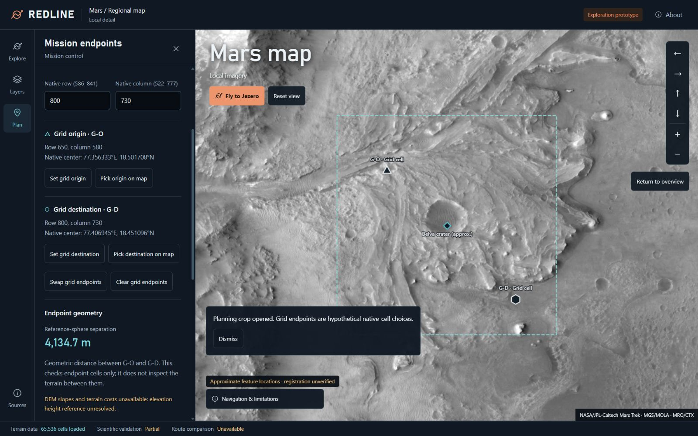
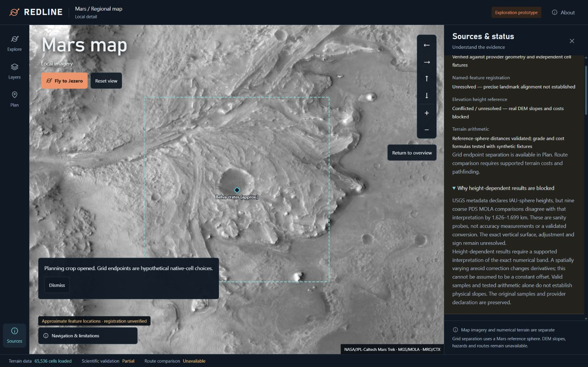

# Scientific evidence and terrain arithmetic — 13 November 2026

This milestone extends clean checkpoint `b853f46`. It completes the source investigation and supported arithmetic implementation; **it does not complete physical DEM slope/cost validation or precise named-feature registration**. No A*, Dijkstra, route comparison, hazard analysis, DEM alteration or coordinate-transform rewrite was performed.

## Evidence and capability boundary

| Area | Result | Current capability |
| --- | --- | --- |
| Native horizontal source geometry | Verified against fresh labels/VRT, four crop corners and seven native center fixtures | Hypothetical native-cell placement and reference-sphere distances |
| Named features | Three active MDIM 2.1 records/conventions rechecked; no landmark residuals or compatible network transform | Approximate references only; no precise science-site registration |
| Exact DEM height reference | Provider sphere declaration conflicts with independent coarse MOLA radius/topography comparison | Preserve source values; no relabelling, conversion or physical slope/cost output |
| Mars distances | Independent PROJ and analytic fixtures pass; latitude-dependent spacing handled | Geometric G-O/G-D separation in Plan; no terrain profile or route length |
| Directional grade and cost arithmetic | Synthetic fixtures and numeric failure cases pass | Tested helpers; real DEM adapters remain blocked |
| Missing support | Endpoint/edge/diagonal-flank tests reject gaps, outside support and nonfinite cells | No interpolation or flat/low-cost substitution |
| Routing | Not implemented in this milestone | Compare routes stays disabled |

The [feature audit](evidence/scientific-validation/feature-registration-audit.md) preserves ten fresh authoritative responses and documents coordinate precision, provider registration lineage and the absence of empirical feature control. Belva's rounded coordinate maps arithmetically to row 714/column 650; it is never silently selected as a planning endpoint. Jezero and Neretva centers are outside the preserved crop.

The [height audit](evidence/scientific-validation/height-reference-audit.md) preserves 13 source responses and nine MOLA range responses. Twelve source requests returned expected authoritative bodies; one PDF URL returned HTML challenge content and was excluded as scientific PDF evidence. Nine native CTX samples were independently rechecked with Rasterio. The CTX-minus-MOLA radial-above-sphere differences are 1.626–1.699 km, versus −51.19 to +17.89 m against MOLA median topography. Resolution/statistics/interpolation and uncertain registration make this a sanity check, not an accuracy estimate or a conversion. An additive constant cancels in derivatives; an unresolved spatially varying areoid correction does not.

## Implemented behavior

`src/data/terrainScience.ts` records separate geometry, feature and vertical findings. Height-dependent adapters fail closed against the exact source ID/hash/units and unresolved vertical evidence. The sealed manifest's original provider-declared qualification remains intact.

`terrainMath.ts` calculates shortest reference-sphere arcs with stable unit-vector cross/dot `atan2`, signed rise/run grade in degrees and percent, and the hypothetical model `d × (1 + w × (rise/run)²)`. The dimensionless nonnegative preference weight is uncalibrated; cost-equivalent metres do not represent actual distance, energy or safety. Balanced multiplication handles representable extreme products; nonzero underflow and overflow produce unavailable results. Synthetic fixtures are never application terrain.

`terrainMetrics.ts` re-reads native cells, retains source provenance, rejects unsupported contracts and distinguishes endpoint separation from a directional adjacent edge. Both diagonal flank cells must be valid. Real source grades/costs are blocked before height subtraction. No intervening terrain is inspected by arbitrary endpoint separation.

`GridMetrics` displays separation only for two supported native endpoints from the loaded source. Missing/mismatched/cleared endpoints remove the measurement. Existing forms, swaps, map-center/keyboard picks, source inspection and layer behavior remain intact. Sources/status/help explain partial scientific validation and the height conflict. The map/globe engine, 65,536 cells and original transformations were preserved.

## Fresh automated checks

| Command | Observed result |
| --- | --- |
| `npm run lint` | Exit 0; no warnings |
| `npm run typecheck` | Exit 0 |
| `npm test` | Exit 0; **415 tests in 31 files** |
| `npm run build` | Exit 0; existing >500 kB chunk warning remains |
| Feature audit `--verify-saved` | Exit 0; ten response hashes, three records and geometry checks |
| Height audit `--verify-saved` | Exit 0; 13 response bodies verified, unexpected HTML excluded |
| MOLA comparison `--verify-saved` | Exit 0; nine range responses and nine probes reproduced |
| Rasterio `verify-native-probes.py` | Exit 0; all nine native samples agree |
| `verify-distances.py` with pyproj 3.7.2 | Exit 0; six analytic/five grid pairs; 256 E-W and 255 N-S row-spacing checks |
| Existing source/crop audit `--verify-saved` | Exit 0; 65,536 cells, zero differing values/float32 bytes |
| `git diff --check` | Exit 0 |

Regression tests were observed failing before fixing near-antipodal distance rounding, cost intermediate overflow/underflow, and nonzero grade underflow. One existing assertion of the old feature-warning text initially failed after its qualification expanded; it was updated without removing source-coordinate coverage. All tests then passed. No new client dependency or lockfile change was made; pyproj/Rasterio ran in temporary uv environments.

Preserved asset SHA-256 values:

- Manifest: `fa63f2181e603eb930d94fcf91444ee5e537b6c046e31537f65daeb0e1cffed9`
- Binary: `4c0e428bb3cc4bcd8cbcebc0c2da2558a106fc19e55cfca352097b7eee32fae8`

## Agent-observed browser acceptance

Testing used a temporary **hidden isolated in-app browser**, never personal browser tabs or native device UI. Production preview ran at loopback port 4183 because 4173 was already occupied; the existing process was left intact. Test failures used the existing loopback-only grid QA harness on 4174. No browser security restriction was bypassed. The browser viewport override was reset and its temporary tab closed afterward.

- [x] Desktop 1600 × 1000: actual controlled CTX imagery/native crop loaded; 65,536 valid cells; form controls, duplicate rejection, 19.0 m adjacent separation, 4,134.7 m nonadjacent separation and swap symmetry.
- [x] Tablet 900 × 1100: one active source drawer, visible scientific findings; no horizontal overflow.
- [x] Mobile 320 × 900: one active Plan bottom sheet, readable distance/limits and persistent scientific/route status; no horizontal overflow.
- [x] Source details: verified geometry versus unresolved feature alignment/height conflict; advanced limitations expand/collapse.
- [x] Keyboard: Enter activates form/summary controls; Escape closes Sources; map arrow pan followed by Enter after current imagery readiness selects a native center and updates separation (observed 1,743.4 m).
- [x] Clearing endpoints removes distance; drawer changes preserve endpoints and terrain.
- [x] Routes remain disabled throughout. No DEM grade/cost/safety result or route line was fabricated.
- [x] Injected terrain HTTP 503: explicit error/retry, no loaded/measurement claim; retry with normal bytes restores 65,536 cells and the honest empty metric state.
- [x] Production console error/warning sample was empty. Injected-failure responses are test evidence, not live NASA service outages.

The preserved globe controls/asset loaded and the regional map rendered actual sources during this smoke check. The full earlier cinematic, responsive and imagery-failure matrices remain historical evidence in the UI/grid checkpoint records; they were not all repeated here. Mathematical NoData/flank cases were automated tests; this browser session injected terrain-service failure, not synthetic Mars terrain.

Visual evidence:

Additional tablet, mobile and failure images are in `docs/evidence/scientific-validation/browser/`.

## Remaining work and next gate

Both requested phases are **partial**. The useful implemented part is native geometry/distance plus tested grade/cost and support-policy foundations. To finish scientific validation, obtain an exact-product final vertical-surface/correction-model/version/sign record and independent compatible height controls, or audit a replacement DEM with a complete vertical contract. Obtain compatible feature-network transformation or independent landmark coordinates/residuals with a justified acceptance criterion for precise named-feature use. Then validate source-derived physical grades/costs. Pathfinding remains a later milestone.
