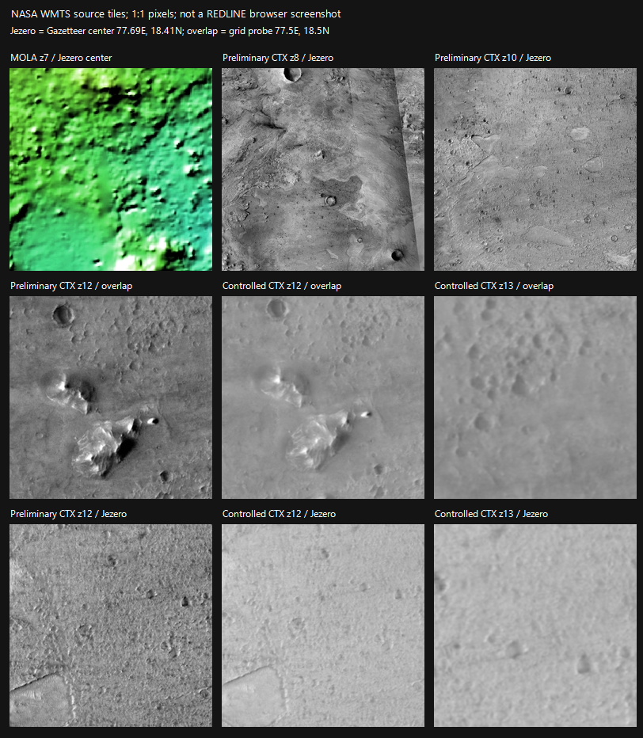

# MOLA and Jezero CTX source audit — 25 October 2026

This is a source and tile audit, not an application rendering acceptance result. Fresh NASA/USGS HTTP responses, raw capabilities, product labels, decoded source images, and a source-only comparison are preserved in `docs/evidence/terrain-detail-audit/ctx-*`. No application code, dependencies, tests, or configuration were changed by this audit. The REDLINE browser origin remains unavailable to the agent.

The existing preliminary CTX service does contain detailed grayscale imagery at its finer advertised levels. The controlled candidate has better documented provenance and one additional WMTS level, but **its two inspected, matching level-12 footprints are visibly softer and lower in contrast than the preliminary mosaic**. Replacing the source is therefore not supported as a guaranteed sharpness fix. MOLA's much coarser native resolution explains its broad, smooth appearance when enlarged.

## Exact capabilities and source resolution

All three capabilities returned HTTP 200 with `Access-Control-Allow-Origin: *` on 25 October 2026 at approximately 18:09 UTC. They use style `default`, matrix set `default028mm`, 256 × 256 tiles, upper-left `[-180, 90]`, and the same global angular grid. Active XML matrix elements were parsed; commented examples were excluded.

| Product | Source resolution evidence | Advertised WMTS matrices | Finest service spacing | Coverage west/south/east/north |
| --- | --- | --- | --- | --- |
| `Mars_MGS_MOLA_ClrShade_merge_global_463m` | USGS: 463.0836 m/pixel, 128 pixels/degree, three-band rendered color relief | `0`–`7`, JPEG | 0.0054931640625°/pixel | `[-180, -89.9991635, 179.9983271, 90]` |
| `Jezero_CTX_BlockAdj_dd` | Trek describes CTX instrument imagery up to 6 m/pixel; the exact preliminary mosaic's native resolution and latitude convention remain unverified | `0`–`12`, grayscale PNG with alpha | 0.000171661376953125°/pixel | `[75.1537692, 15.9058484, 78.8717121, 19.4453003]` |
| `JEZ_ctx_B_soc_008_orthoMosaic_6m_Eqc_latTs0_lon0` | USGS ISIS/PDS labels: 6 m/pixel, 5322 × 5040, one unsigned-byte image band | `0`–`13`, grayscale PNG with alpha | 0.0000858306884765625°/pixel | `[77.1604655, 18.2110274, 77.6991776, 18.7211945]` |

Capabilities: [MOLA](https://trek.nasa.gov/tiles/Mars/EQ/Mars_MGS_MOLA_ClrShade_merge_global_463m/1.0.0/WMTSCapabilities.xml), [preliminary CTX](https://trek.nasa.gov/tiles/Mars/EQ/Jezero_CTX_BlockAdj_dd/1.0.0/WMTSCapabilities.xml), [controlled CTX](https://trek.nasa.gov/tiles/Mars/EQ/JEZ_ctx_B_soc_008_orthoMosaic_6m_Eqc_latTs0_lon0/1.0.0/WMTSCapabilities.xml). Native source records: [USGS MOLA](https://astrogeology.usgs.gov/search/map/mars_mgs_mola_global_color_shaded_relief_463m), [USGS controlled CTX](https://astrogeology.usgs.gov/search/map/Mars/Mars2020/JEZ_ctx_B_soc_008_orthoMosaic_6m_Eqc_latTs0_lon0).

Tile matrix widths are `2^(z+1)` and heights are `2^z`, so the independently derived angular spacing is `0.703125 / 2^z` degrees/pixel. The following values are **display-grid sampling on the documented 3,396,190 m sphere**, calculated as `degrees/pixel × pi × radius / 180`. They are not measured resolving power; east–west ground spacing also varies with latitude.

| Matrix | Nominal sphere sampling |
| --- | --- |
| 7 | 325.606 m/pixel |
| 8 | 162.803 m/pixel |
| 9 | 81.401 m/pixel |
| 10 | 40.701 m/pixel |
| 11 | 20.350 m/pixel |
| 12 | 10.175 m/pixel |
| 13 | 5.088 m/pixel |

MOLA's highest tile grid already samples its 128-pixel/degree source about 1.422 times more densely. The controlled CTX level-13 grid samples its 6 m source about 1.179 times more densely. Neither resampling creates new measured resolution. Level 8 and level 12 differ by 16 times in linear display sampling; remaining at level 8 will not expose the finest imagery this CTX service can supply. Calculation inputs and formulas are in `ctx-resolution-comparison.json`.

## Coordinate conventions and candidate limitations

All three WMTS documents still advertise `urn:ogc:def:crs:EPSG::104905`. Their shared explicit angular tile geometry is consistent with REDLINE's service-grid treatment, but the authority-string and scale-denominator discrepancy documented in [data-sources.md](data-sources.md) remains. A generic Earth or Web Mercator interpretation would be incorrect. This audit does not replace that explicit grid with a generic capabilities-derived scale conversion.

The [controlled product's ISIS label](https://asc-pds-services.s3.us-west-2.amazonaws.com/mosaic/mars2020_trn/CTX/JEZ_ctx_B_soc_008_orthoMosaic_6m_Eqc_latTs0_lon0.lbl) and [PDS3 label](https://asc-pds-services.s3.us-west-2.amazonaws.com/mosaic/mars2020_trn/CTX/JEZ_ctx_B_soc_008_orthoMosaic_6m_Eqc_latTs0_lon0_pds3.lbl) explicitly establish planetocentric latitude, positive-east longitude, a 180° longitude domain, equirectangular projection centered on 0° latitude/longitude, and equal radii of 3,396,190 m. The corresponding [geographic VRT](https://asc-pds-services.s3.us-west-2.amazonaws.com/mosaic/mars2020_trn/CTX/JEZ_ctx_B_soc_008_orthoMosaic_6m_Eqc_latTs0_lon0_dd.vrt) records:

```text
origin longitude/latitude = [77.160465459223644, 18.7211944818728]
x/y pixel steps = [+0.00010122362914869109, -0.00010122362914869109] degrees
band interpretation = Gray; NoData = 0
reprojection resampling = NearestNeighbour
```

The [FGDC metadata](https://asc-pds-services.s3.us-west-2.amazonaws.com/mosaic/mars2020_trn/CTX/JEZ_ctx_B_soc_008_orthoMosaic_6m_Eqc_latTs0_lon0.xml) documents orthorectification, stereo processing, and alignment to an HRSC reference. It credits Robin Fergason, Donna Galuszka, Trent Hare, David Mayer, Bonnie Redding, and Ethan Smith, with USGS Astrogeology as publisher; publication date is 24 July 2020. That publication date is not an image-acquisition date. Retain these authors and [DOI 10.5066/P9GV1ND3](https://doi.org/10.5066/P9GV1ND3), plus NASA/MRO/CTX and Mars Trek attribution, if the product is adopted. The labels and source record describe imagery, not numerical elevation. No quantitative registration between the two CTX mosaics was established here.

The current preliminary product cannot inherit these native conventions merely because both products include “Jezero” in their names. Its catalog's “Global” coverage field is contradicted by the actual regional bounds. The candidate's Trek catalog/FGDC east edge also differs slightly from the exact native-label/WMTS east edge; preserve exact WMTS bounds for service clipping and source alpha for actual image support, without treating the entire rectangle as guaranteed valid imagery.

The [USGS/IAU Gazetteer](https://planetarynames.wr.usgs.gov/Feature/14300) currently places Jezero's center at 77.69°E, 18.41°N in its planetocentric, positive-east system, with approximate bounds 77.27–78.11°E and 18.01–18.81°N. The controlled CTX bounds cover only part of this crater region. A wholesale replacement would remove much of the preliminary mosaic's coverage. The former is suitable to evaluate as a specifically bounded controlled landing-region image, not a whole-Jezero replacement inferred from its name.

## Actual source-tile probes and inspection

Requests used the exact capabilities ResourceURL, including its double slash after `1.0.0/`, with `Origin: http://127.0.0.1:5173`. These are external source requests made by a command-line HTTP client; the Origin header and returned CORS header do not establish an actual browser-origin request or REDLINE rendering.

| Probe | Observed result |
| --- | --- |
| MOLA `7/50/183.jpg`, containing the Gazetteer center | HTTP 200; decoded 256 × 256 color image |
| Preliminary CTX Gazetteer-center tiles at levels 8, 10, 12 | HTTP 200; distinct 256 × 256 grayscale images with visible source texture |
| Controlled CTX Gazetteer-center tiles at levels 12, 13 | HTTP 200; decoded 256 × 256 grayscale images |
| Both CTX products at matching overlap footprints: `10/406/1464.png`, `12/1627/5859.png` | HTTP 200; comparison possible on identical service-grid extents |
| Controlled `13/3254/11719.png` at the same overlap probe | HTTP 200; 256 × 256 grayscale image |
| Preliminary `13/3254/11719.png` | HTTP 404 with no CORS header; this level is not advertised |
| Controlled `12/1645/5848.png` at the existing broad mosaic-midpoint shortcut | HTTP 404 with no CORS header; outside this smaller source's bounds |
| Controlled east-boundary `12/1629/5864.png` | HTTP 200 with 59,136 fully transparent pixels, 768 partly transparent, and 5,632 opaque |
| Preliminary west-boundary `12/1629/5806.png` | HTTP 200 with 10,496 fully transparent pixels, 768 partly transparent, and 54,272 opaque |

All 13 successful tile responses returned CORS `*` and decoded as 256 × 256. Every decoded CTX pixel with nonzero alpha had equal red, green, and blue values; CTX remains grayscale. Partial boundary alpha must remain transparent over the base layer. Failed requests must not become substitute valid terrain. Hashes, URLs, response headers, probe meanings, and exact tile extents are in `ctx-tile-http-probes.json`; decoded dimensions and alpha counts are in `ctx-decoded-image-dimensions.json`.

The overlap position `[77.5, 18.5]` is an explicitly arbitrary grid test point inside both advertised bounds, not an invented science target. The separate center probes use the sourced Gazetteer coordinates. Similar-looking features in two tiles are not used as proof of fine registration.



The comparison was inspected locally with `view_image`. Each source tile occupies exactly 256 × 256 output pixels; explicit source/destination pixel rectangles avoid the JPEG's DPI metadata altering its display size. The middle and bottom rows show the softer controlled samples against current preliminary imagery at the same level. The controlled level-13 column is a smaller footprint at a finer grid, not an equal-footprint comparison. No sharpening, colorization, synthetic terrain, or elevation decoding was applied.

## Recommendation and verification boundary

Retain the current CTX source while correcting the documented destination/framing issue from the implementation audit. Then inspect the actual application's requests at finer CTX matrices and its visible result. The evidence supports source resolution and initial framing as important limits; it does not demonstrate that switching to the controlled mosaic would produce sharper terrain.

Consider the controlled mosaic later for its documented geodetic provenance, bounded landing-region coverage, and extra grid level. Acceptance would still require actual browser rendering, coverage, cross-layer placement, and error-state inspection. Existing imagery and either source's visual texture must remain separate from any future numerical DEM or route calculations.

This sub-audit ran live capability/source/tile HTTP probes, XML parsing, source-label review, display-grid calculations, image decoding, alpha/channel inspection, and local source-image viewing. No automated application tests or production build were run by this sub-audit because it changed no implementation; the parent audit owns those baseline checks. There is no new application browser PASS, implementation fix, success checkpoint commit, or push from this work.
