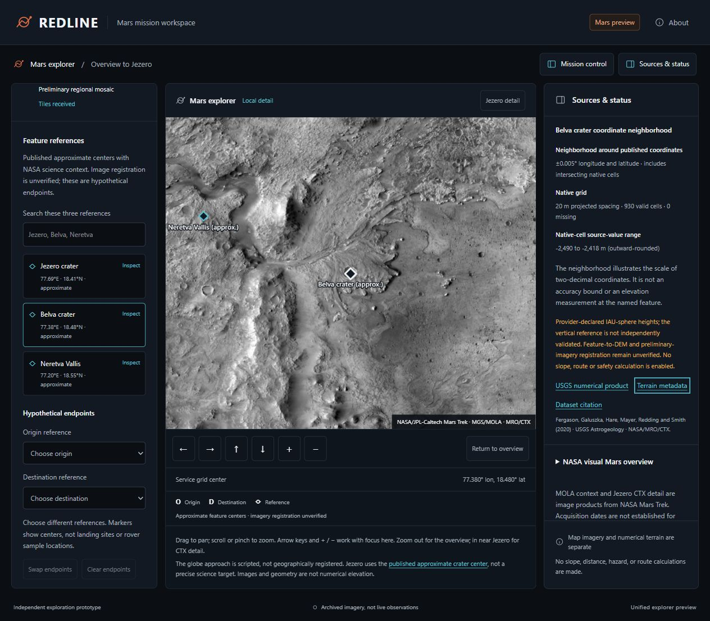

# Jezero numerical terrain validation — 13 November 2026

This milestone adds independently verified numerical source inspection to REDLINE. It preserves the globe, Mars Trek image layers, three sourced feature references and hypothetical endpoints from checkpoint `b486eed`. It does not enable precise feature heights, terrain overlays, slope, hazards, route metrics or route comparison.

## Implemented and browser-tested

**Load numerical terrain** fetches only `/data/jezero-terrain-windows.json`. The loader checks HTTP status, JSON media type, a bounded size, exact response-byte SHA-256, UTF-8 and the typed numerical contract before exposing values. Failed requests and mismatched bytes show an error and **Retry numerical terrain**. Abort/timeout handling rejects stale or unavailable results.

Inspecting Jezero, Belva or Neretva shows an independently qualified coordinate-neighborhood count and source-value range, with native 20 m projected spacing, dataset links, authors and vertical/registration limits. No precise named-site elevation is displayed. Loaded state persists through reference/endpoint changes and panel hiding; it resets on reload. Terrain loading is independent of imagery and model requests.

The loader pins canonical UTF-8/LF bytes. The extraction script writes bytes explicitly and `.gitattributes` preserves the exact JSON/evidence bytes on every checkout. Independent review identified and resolved two integrity defects: metadata-only validation could accept changed finite cells, and Git/OS newline conversion could invalidate a pinned checksum.

## Data-backed source contract

Product: **`JEZ_ctx_B_soc_008_DTM_MOLAtopography_DeltaGeoid_20m_Eqc_latTs0_lon0`**.

- [USGS product page](https://astrogeology.usgs.gov/search/map/mars_2020_terrain_relative_navigation_ctx_dtm_mosaic)
- [Exact numerical GeoTIFF](https://asc-pds-services.s3.us-west-2.amazonaws.com/mosaic/mars2020_trn/CTX/JEZ_ctx_B_soc_008_DTM_MOLAtopography_DeltaGeoid_20m_Eqc_latTs0_lon0.tif)
- [Provider FGDC metadata](https://asc-pds-services.s3.us-west-2.amazonaws.com/mosaic/mars2020_trn/CTX/JEZ_ctx_B_soc_008_DTM_MOLAtopography_DeltaGeoid_20m_Eqc_latTs0_lon0.xml)
- Citation: Robin Fergason, Donna Galuszka, Trent Hare, David Mayer, Bonnie Redding and Ethan Smith (2020), USGS Astrogeology, NASA/MRO/CTX, [DOI 10.5066/P906QQT8](https://doi.org/10.5066/P906QQT8). Provider metadata lists no access/use constraints and requests author citation; its quality/no-warranty limits remain applicable.

| Field | Verified contract |
| --- | --- |
| Raster | 1596 columns × 1512 rows × one band, little-endian float32, scale 1 / offset 0 |
| Organization | Uncompressed, one-row TIFF strips; no overview pyramid; not a COG |
| Body / coordinates | Sphere R=3,396,190 m; planetocentric latitude / east-positive longitude |
| Projection | Equirectangular; standard parallel, central meridian and false offsets all zero |
| Geotransform | `[4573663.250853,20,0,1109693.140188,0,-20]`, projected metres |
| Pixel convention | Outer corner at (0,0), cell centers at half-pixels; rows increase southward; east/south edges exclusive |
| NoData | `-3.4028226550889045e38`; explicit null in derived windows; never zero-filled |
| Decoded source support | 2,413,152 valid cells; zero NoData/non-finite cells in these exact bytes |
| Actual native range | −2710.69580078125 to −1515.53955078125 m |
| Provider catalog range | −2710.414794921875 to −1522.2337646484375 m; differs from downloaded payload |
| Height qualification | Provider-declared IAU-sphere metre heights; vertical reference not independently validated |

The `DeltaGeoid` filename token does not establish an areoid conversion. No vertical transformation is applied. All-valid cells are not an accuracy or complete stereo-support guarantee; the product has no per-cell origin/quality mask distinguishing blended/filled support. Provider registration metrics describe its processing lineage, not registration to REDLINE's preliminary CTX or Gazetteer centers.

Raw GeoTIFF: **9,662,387 bytes**, SHA-256 **`16a1aa66c3f48c1bca252795827db7b417876217aff0f5e1aff18027fab2327b`**.

Derived JSON: **52,868 bytes**, **2,821 native cells**, SHA-256 **`7b655f1593091fede555394f2c685386b6a677ed4ca1a8ac0eb910130ea5928a`**.

The full TIFF is saved audit evidence and is absent from the production output. The client uses native cells intersecting ±0.005° neighborhoods around the existing published two-decimal centers. There is no resampling, interpolation, synthetic terrain or datum change. These neighborhoods illustrate coordinate quantization; they are not a positional accuracy bound.

| Reference neighborhood | Native dimensions | Valid / missing | UI outward-rounded source range |
| --- | --- | --- | --- |
| Jezero crater | 31 rows × 31 columns | 961 / 0 | −2,633 to −2,626 m |
| Belva crater | 30 rows × 31 columns | 930 / 0 | −2,490 to −2,418 m |
| Neretva Vallis | 31 rows × 30 columns | 930 / 0 | −1,992 to −1,899 m |

## Verification actually performed

| Command/check | Observed result |
| --- | --- |
| `uv run --with rasterio --with numpy python scripts/prepare-terrain-windows.py` | Exit 0; native hash/grid/encoding/CRS verified; deterministic windows generated with Rasterio 1.5.2 / GDAL 3.12.2 |
| `node docs/evidence/terrain-validation/verify-evidence.mjs` | Exit 0; 20 saved response hashes, 2 range-body hashes, 3 native fixtures, canonical derived hash/bytes verified |
| Independent raw-TIFF extraction review | All 2,821 derived values matched separately decoded native TIFF strip values; three window statistics matched |
| `npm run lint` | Exit 0; no ESLint errors or warnings |
| `npm run typecheck` | Exit 0 |
| `npm test` | Exit 0; 223 tests in 20 files, including 48 focused terrain tests |
| `npm run build` | Exit 0; 243 modules; 36.12 kB CSS, 602.30 kB main JS, 637.33 kB lazy globe JS. Existing >500 kB chunk warning remains |
| Browser development and production preview | PASS — agent-observed background in-app browser; no personal browser or native app controls used |

Terrain tests include independent Rasterio samples and provider geometry, pixel-center/edge conventions, longitude wrapping, unsupported conventions, shifted/truncated windows, malformed contracts, float32/NoData/all-missing propagation, outside coverage, HTTP/format/network failures, timeout/cancellation and altered finite-value checksum rejection. Synthetic edge/NoData fixtures are tests only, never Mars observations.

Browser checks on localhost development (5173), QA (5174) and production preview (4173) observed:

- Load by Enter with no selected reference, then correct counts/ranges for all three references.
- Loaded values persist across reference changes, endpoint assignment/swap and panel hide/show.
- Existing map imagery renders; CTX/MOLA switches, both-hidden message and restoration work in production. Routes remain disabled.
- QA HTTP 503 shows an actionable error/retry. A valid float32 sample deliberately changed by the harness fails the exact-byte integrity check. A delayed actual asset shows loading and then recovers through retry. Modes were returned to normal.
- 320×800 and 768×1024 layouts retain keyboard-reachable source controls and readable limitations. Document scroll width remained inside each viewport; temporary viewport overrides were reset.
- Production preview accepted the canonical real local asset after rebuild and displayed real Mars Trek tiles. Captured production and QA warning/error logs were empty. This is a smoke test, not an exhaustive accessibility/performance audit.

The loopback-only harness is `docs/evidence/terrain-validation/browser-qa-server.mjs`. Run with Node and POST JSON `{"mode":"normal"}`, `fail`, `tamper` or `slow` to `http://127.0.0.1:5174/__qa/mode`. Injected responses are visibly disclosed; application and source files are never modified. Normal/delayed modes serve actual local bytes. The failed preview connection after a conversation/server restart was resolved by restarting preview; it was not a product defect.

Exact source HTTP probes returned 200; matching byte ranges returned 206; CORS/preflight headers were inspected by CLI. This does **not** establish a direct browser TIFF request. The browser never needs that request: preprocessing uses the archived source, and runtime acceptance was verified against the same-origin derived asset.

## Evidence and changed areas

- `src/features/terrain/`: typed contract, validation, sampling, source-window loading and tests.
- `src/components/mission/TerrainInspection.tsx`, `InformationPanel.tsx`, `src/styles/index.css`: working independent inspection and source footer.
- `scripts/prepare-terrain-windows.py`, `public/data/jezero-terrain-windows.json`: reproducible native extraction and bounded asset.
- `.gitattributes`: exact-byte preservation; `README.md` and the implementation plan: setup/status/handoff.
- [Source audit](evidence/terrain-validation/source-audit/audit.md), [registration audit](evidence/terrain-validation/registration-audit.md), `raster-inspection.json`: raw receipts, source contract, native statistics and independent fixtures.

## Incomplete and next milestone

The numerical source is verified for qualified inspection. The named centers retain approximate MDIM 2.1 geometry; their fine registration to the DEM and current preliminary imagery is unresolved. The disjoint extracted windows are not a route grid. Neither rendered imagery nor the visual globe provides elevation.

Next, select controlled imagery with documented shared DEM lineage or establish measured registration to the preliminary mosaic. Verify pixel/corner mapping, browser service behavior and valid numerical support, then offer explicit hypothetical grid-cell endpoints. Only afterward implement physically valid Mars distance/slope math and documented nonnegative terrain costs before comparing routes. Provider-declared heights must not be mixed with an areoid dataset without a validated conversion.

Route objectives/comparison, science weighting, report export, deployment and submission acceptance remain incomplete. There is no simulation-only terrain or route output in the app.
